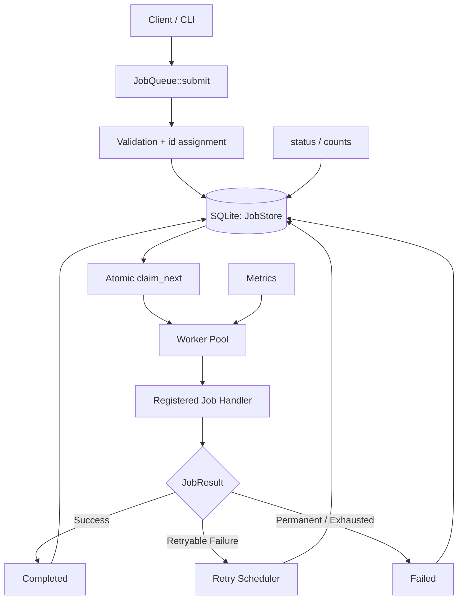

# Persistent C++ Job Queue

A persistent, multithreaded background job-processing system built with **C++20, SQLite, and CMake**. The system accepts jobs asynchronously, executes them through a configurable worker pool, tracks job lifecycle states, and supports retry scheduling and recovery of pending work after application restarts.

## Overview

Background tasks such as report generation, file processing, and notifications can increase request latency when executed synchronously. A job queue separates task submission from task execution, allowing applications to accept work quickly while processing jobs in the background.

This project implements a single-machine job queue with thread-safe scheduling, persistent job metadata, configurable retry policies, and performance benchmarking.

### Key Features

- **Multithreaded execution:** Configurable worker threads process independent jobs concurrently.
- **Thread-safe queue:** Uses C++ synchronization primitives to coordinate producers and workers.
- **Persistent storage:** SQLite stores job metadata and lifecycle state.
- **Job lifecycle management:** Tracks queued, running, completed, and failed jobs.
- **Retry mechanism:** Supports bounded retries with exponential backoff.
- **Delayed scheduling:** Allows jobs to become eligible for execution at a specified time.
- **Crash recovery:** Reconstructs pending work from persistent records after restart.
- **Graceful shutdown:** Coordinates worker termination and resource cleanup.
- **Performance benchmarking:** Measures throughput and queue latency.
- **Automated testing:** Validates queue behavior, concurrency, and recovery scenarios.

> Execution guarantees are explicitly documented. Persistent storage alone does not guarantee exactly-once execution of external side effects. See [Reliability and Failure Handling](#reliability-and-failure-handling).

## Architecture



### How It Works

1. A client submits a job with a type and an opaque payload.
2. The system assigns a unique job ID and commits the row to SQLite **before** `submit()` returns, so a returned ID is durably accepted.
3. Workers wait on a condition variable and wake when work is submitted or when a delayed job becomes eligible.
4. A worker **atomically claims** the earliest-eligible queued job (a single `UPDATE ... RETURNING`), transitioning it to `running`. Two workers can never claim the same job.
5. The worker executes the registered handler for the job's type **outside every lock**, so long-running work never blocks other workers.
6. Successful jobs are marked `completed`; failed jobs are retried with backoff or marked `failed` according to policy.
7. Clients retrieve status with `status(id)` / `counts()`.
8. On startup, `start()` runs recovery: any job left `running` by a crashed process is returned to `queued`.

## Technology Stack

| Technology       | Purpose                                                |
| ---------------- | ------------------------------------------------------ |
| C++20            | Core queue engine, worker pool, and synchronization    |
| SQLite           | Persistent job storage and transactional state updates |
| CMake            | Build configuration                                    |
| GCC / G++        | Compilation                                            |
| GoogleTest       | Unit and integration testing (fetched via CMake)       |
| ThreadSanitizer  | Detecting data races                                   |
| AddressSanitizer | Detecting memory safety errors                         |

The core engine (`libjobqueue`) is independent of any frontend. An HTTP API can be layered on top without changing it.

## Project Structure

```text
cpp-job-queue/
├── include/
│   ├── job.hpp          # Job, JobState, JobResult, RetryPolicy, handler types
│   ├── job_store.hpp    # SQLite persistence layer (thread-safe)
│   └── job_queue.hpp    # Queue engine + worker pool + metrics
├── src/
│   ├── job.cpp          # state strings, backoff computation
│   ├── job_store.cpp    # SQLite schema, atomic claim, recovery
│   ├── job_queue.cpp    # worker loop, retry handling, shutdown, metrics
│   └── main.cpp         # demonstration CLI
├── tests/
│   ├── test_util.hpp            # self-cleaning temp-DB helper
│   ├── job_queue_tests.cpp      # lifecycle, retries, delays, failures
│   ├── concurrency_tests.cpp    # many producers/workers, exactly-once
│   └── recovery_tests.cpp       # persistence + restart recovery
├── benchmarks/
│   └── benchmark.cpp
├── CMakeLists.txt
├── README.md
└── .gitignore
```

## Job Lifecycle

A job moves through the following states:

- `Queued`: Accepted and waiting to become eligible / be claimed.
- `Running`: Claimed by a worker.
- `Completed`: Successfully executed.
- `Failed`: Permanent failure, or retries exhausted.

Retryable failures return a job to `Queued` with a future `available_at`. All transitions are persisted.

## API Sketch

```cpp
#include "job_queue.hpp"
using namespace jobq;

JobQueue queue("jobs.db");               // ":memory:" for an ephemeral store

queue.register_handler("email", [](const Job& j) {
    if (!send_email(j.payload)) return JobResult::retry("smtp timeout");
    return JobResult::success();
});

queue.start(4);                          // runs crash recovery, spawns 4 workers

int64_t id = queue.submit("email", R"({"to":"a@b.com"})");

SubmitOptions opts;
opts.max_attempts = 5;
opts.delay = std::chrono::seconds(30);   // delayed scheduling
queue.submit("email", payload, opts);

queue.drain();                           // wait until no work remains (optional)
queue.shutdown();                        // graceful stop + join
```

A handler returns one of `JobResult::success()`, `JobResult::retry(msg)`, or `JobResult::fail(msg)`. Exceptions thrown from a handler are caught and treated as retryable failures. An unknown job type fails permanently rather than spin-claiming.

## Reliability and Failure Handling

### Retry Policy

The queue supports a configurable maximum number of attempts and exponential backoff. The retry delay follows:

```
d_n = min(d_max, d_0 × 2^(n-1))
```

Where `d_0` is the initial delay, `d_max` the maximum delay, and `n` the 1-based retry number. The computation saturates, so large retry counts cannot overflow into a small or negative delay.

### Persistence and Recovery

SQLite (in WAL mode) is the single source of truth for job state. During `start()`, the queue reconciles stored jobs: any job left `running` by a previous process is returned to `queued` and retried.

Interrupted jobs require an explicit recovery policy because a process can crash **after** performing an external action but **before** recording completion. The attempt counter is incremented at claim time, so a recovered job counts its interrupted run as an attempt. **Idempotent handlers and deduplication are the application's responsibility** — persistence does not provide exactly-once side effects.

### Concurrency

The worker pool uses `std::mutex`, `std::unique_lock`, and `std::condition_variable` to coordinate access and avoid busy-waiting. Workers execute job handlers **outside** every lock so long-running work does not prevent other workers from claiming jobs.

Lock ordering is designed to be deadlock-free: `submit()` and retry-scheduling complete their store write (releasing the store lock) **before** taking the wait mutex to notify a worker, while a worker holds the wait mutex across *claim + wait*. This ordering also closes the missed-wakeup window. The design is validated under ThreadSanitizer (see below).

## Build and Run

### Prerequisites

- Linux or another supported C++ environment
- GCC/Clang with C++20 support
- CMake ≥ 3.16
- SQLite development libraries

On Ubuntu:

```bash
sudo apt update
sudo apt install build-essential cmake git sqlite3 libsqlite3-dev
```

GoogleTest is fetched automatically by CMake if it is not already installed (requires network on first configure; disable with `-DJOBQ_BUILD_TESTS=OFF`).

### Build

```bash
cmake -S . -B build
cmake --build build -j
```

### Run

```bash
./build/job_queue [db_path] [num_workers]      # defaults: jobs.db 4
```

The CLI registers example handlers (`print`, `flaky`, `doomed`), submits a mix of jobs including a delayed one and a retrying one, drains the queue, and prints a summary. Re-running against the same `db_path` shows prior jobs and recovers any left behind.

## Testing

```bash
ctest --test-dir build --output-on-failure
```

Test categories:

- **Functional** (`job_queue_tests.cpp`): submission, lifecycle transitions, retry success/exhaustion, permanent failure, unknown-type failure, handler exceptions, delayed scheduling, backoff math.
- **Concurrency** (`concurrency_tests.cpp`): many producers and workers, exactly-once execution (no job runs twice), shutdown while submitting.
- **Recovery** (`recovery_tests.cpp`): state survives restart, queued work resumes, interrupted `running` jobs are requeued and finished.

All 16 tests currently pass.

### Sanitizer Checks

ThreadSanitizer:

```bash
cmake -S . -B build-tsan -DCMAKE_BUILD_TYPE=Debug -DJOBQ_BUILD_BENCHMARKS=OFF \
  -DCMAKE_CXX_FLAGS="-fsanitize=thread -g -O1" \
  -DCMAKE_EXE_LINKER_FLAGS="-fsanitize=thread"
cmake --build build-tsan -j --target job_queue_tests

# On kernels with high ASLR entropy, disable randomization for the run:
setarch "$(uname -m)" -R ./build-tsan/job_queue_tests
```

The full test suite passes under ThreadSanitizer with **no data-race reports**. (A clean sanitizer run does not prove the absence of every race.) AddressSanitizer can be enabled the same way with `-fsanitize=address,undefined`.

## Performance Benchmarking

```bash
./build/benchmark [num_jobs] [num_workers]     # defaults: 50000 4
```

The harness runs a no-op handler against both an in-memory and an on-disk store and reports throughput and queue-latency percentiles.

**Example run** — Intel Core i5-9300H (8 logical cores), g++ 13.3.0, `-O3` Release, SQLite 3.45 (WAL), 50,000 jobs, 4 workers:

| Metric               | In-memory store | On-disk store (WAL) |
| -------------------- | --------------- | ------------------- |
| Throughput           | ~6,200 jobs/s   | ~2,900 jobs/s       |
| p50 queue latency    | ~0 ms           | ~0 ms               |
| p95 queue latency    | ~1 ms           | ~1 ms               |
| p99 queue latency    | ~5 ms           | ~10 ms              |
| Persistence overhead | baseline        | ~2.1× slower        |

Throughput is `completed jobs / elapsed seconds`; queue latency is the time from a job becoming eligible (`available_at`) to a worker claiming it. These numbers are specific to the hardware and settings above and will vary. A known optimization opportunity is caching prepared SQLite statements per connection rather than preparing per operation.

## Design Decisions

- **C++20:** Control over threads, synchronization, and resource management.
- **SQLite as source of truth:** Self-contained persistence; claims are a single atomic statement, so correctness does not depend on in-memory bookkeeping staying in sync with the store.
- **Worker pool:** Reuses a bounded number of threads rather than one thread per job.
- **Handlers run outside locks:** Keeps the queue responsive under long-running jobs.
- **Explicit retry policy:** Bounds repeated failures and backs off load on dependencies.
- **Benchmark-driven:** Performance claims come from measurement, not assumption.

## Limitations

- Single machine, not a distributed cluster.
- A single mutex-guarded SQLite connection serializes store operations; it can become a bottleneck under high write contention.
- External side effects may be repeated after interrupted execution (at-least-once).
- Throughput and latency depend on workload, hardware, and persistence settings.

## Development Roadmap

- [x] Thread-safe queue with condition-variable coordination.
- [x] Reusable worker pool and typed job handlers.
- [x] SQLite-backed persistence.
- [x] Retry policies and delayed scheduling.
- [x] Startup recovery and graceful shutdown.
- [x] Functional, concurrency, and recovery tests (+ ThreadSanitizer).
- [x] Benchmark suite (throughput, latency, persistence overhead).
- [ ] Optional HTTP API and job-status endpoints.
- [ ] Job priorities and per-job timeouts.
- [ ] Bounded queue capacity and backpressure.
- [ ] Prepared-statement caching for higher throughput.
- [ ] Structured logging and operational metrics export.

## Learning Outcomes

- Multithreaded programming and synchronization in C++.
- Producer–consumer architecture and worker pools.
- Database transactions and persistent state.
- Failure recovery, retries, and idempotency.
- Performance measurement and bottleneck analysis.
- Automated testing and maintainable project structure.

---

**Author:** Vaidehi Turkar
**Language:** C++20
**Project focus:** Backend systems engineering, concurrency, persistence, and performance.
**Status:** Core engine implemented and tested. HTTP API and further enhancements are future work.
